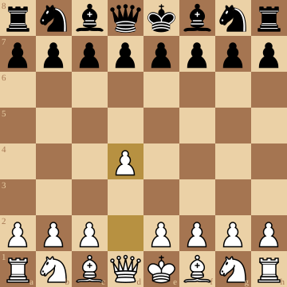

# image

## Introduction

**image** is a chess image utility that converts board positions into [SVG](https://en.wikipedia.org/wiki/Scalable_Vector_Graphics) images and animated GIFs. [svgo](https://github.com/ajstarks/svgo) constructs SVG documents, while [oksvg](https://github.com/srwiley/oksvg) and [rasterx](https://github.com/srwiley/rasterx) rasterize the embedded piece SVGs for GIF output.

## Usage

### Animated GIF

`GIF` writes an animation from a sequence of board positions. The delay is measured in hundredths of a second; this example uses 50 hundredths (half a second) per frame. The animation loops indefinitely.

```go
game := chess.NewGame()
boards := []*chess.Board{game.Position().Board()}
if err := game.MoveStr("e4"); err != nil {
	log.Fatal(err)
}
boards = append(boards, game.Position().Board())

file, err := os.Create("game.gif")
if err != nil {
	log.Fatal(err)
}
defer file.Close()

if err := image.GIF(file, boards, 50); err != nil {
	log.Fatal(err)
}
```

### SVG 

The SVG function is the primary exported function of the package.  It writes an SVG document to the io.Writer given.  

```go
file, _ := os.Open("output.svg")
defer file.Close()
fenStr := "rnbqkbnr/pppppppp/8/8/3P4/8/PPP1PPPP/RNBQKBNR b KQkq - 0 1"
pos := &chess.Position{}
pos.UnmarshalText([]byte(fenStr))
image.SVG(file, pos.Board())
```

### Dark / Light Square Customization

The default colors, shown in the example SVG below, are (235, 209, 166) for light squares and (165, 117, 81) for dark squares.  The light and dark squares can be customized using the SquareColors() option. 

```go
white := color.RGBA{255, 255, 255, 1}
gray := color.RGBA{120, 120, 120, 1}
sqrs := image.SquareColors(white, gray)
image.SVG(file, pos.Board(), sqrs)
```

### Marked Squares

MarkSquares is designed to be used as an optional argument to the SVG function.  It marks the given squares with the color.  A possible usage includes marking squares of the previous move.

```go
yellow := color.RGBA{255, 255, 0, 1}
mark := image.MarkSquares(yellow, chess.D2, chess.D4)
image.SVG(file, pos.Board(), mark)
```

### Perspective

Perspective is designed to be used as an optional argument
to the SVG function.  It draws the board from the perspective
of the given color.  White is the default.  The following 
generates a board from Black's perspective:

```go
fromBlack := image.Perspective(chess.Black)
image.SVG(file, pos.Board(), fromBlack)
```

### Example Program

```go
package main

import (
	"image/color"
	"log"
	"os"

	"github.com/corentings/chess"
	"github.com/corentings/chess/image"
)

func main() {
    // create file
    f, err := os.Create("example.svg")
    if err != nil {
        log.Fatal(err)
    }
    defer f.Close()

    // create board position
    fenStr := "rnbqkbnr/pppppppp/8/8/3P4/8/PPP1PPPP/RNBQKBNR b KQkq - 0 1"
    pos := &chess.Position{}
    if err := pos.UnmarshalText([]byte(fenStr)); err != nil {
        log.Fatal(err)
    }

    // write board SVG to file
    yellow := color.RGBA{255, 255, 0, 1}
    mark := image.MarkSquares(yellow, chess.D2, chess.D4)
    if err := image.SVG(f, pos.Board(), mark); err != nil {
        log.Fatal(err)
    }
}
```

### Example Program Result


 
